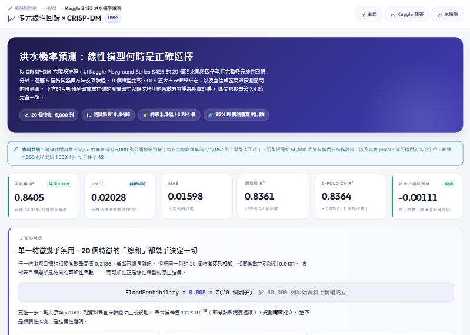
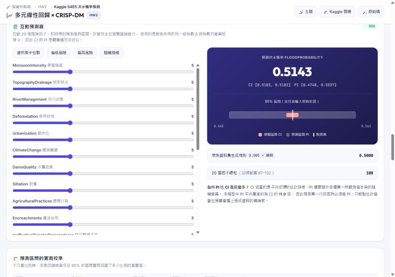

# HW2 — 多元線性回歸 × CRISP-DM
### Kaggle Playground Series S4E5：Flood Prediction

**🌐 互動網站：<https://zxc22872580.github.io/AIoT-HW2-FloodRegression/>**

以 **CRISP-DM** 六階段流程，對 Kaggle 洪水機率預測資料集（20 個特徵）執行完整的多元線性回歸分析，
包含**特徵選擇**、**模型評估**、**OLS 五大假設檢定**，以及**含信賴區間與預測區間的預測圖**。

---

## 📌 核心發現

以**真實 Kaggle 競賽資料**（5,000 列公開鏡像抽樣）執行，所有數值來自 `outputs/results.json`。

| 發現 | 內容 |
|---|---|
| **生成規則被直接證明** | 載入原始 50,000 列資料集驗證 `目標 = 0.005 × 總和` 精確成立，最大偏差 1.11×10⁻¹⁶ |
| **可加性結構** | 單一特徵與目標相關係數僅 0.2136，20 特徵**逐列總和**達 0.9131 |
| **最終模型表現** | 多元線性回歸測試集 R² = **0.8405**，冠軍為 0.86905（資料量僅其 1/224） |
| **特徵選擇結論：全部保留** | k-sweep 嚴格遞增至 k=20；僅留 10 特徵時 R² 掉到 0.3455 |
| **兩項 OLS 假設被違反** | 異質變異 p≈10⁻¹⁸、殘差偏態 +0.76，已加計 HC3 穩健標準誤，僅 1 項邊界特徵受影響 |
| **預測區間實測校準** | 95% PI 實際覆蓋 **92.90%**，低估 2.1 個百分點，報告中如實揭露 |
| **Kaggle 名次定位** | 真實 private leaderboard 2,794 隊，本模型約第 2,341 名（榜單極度壓縮，見報告 §7.1） |

---

## 🌐 互動網站

<https://zxc22872580.github.io/AIoT-HW2-FloodRegression/>

純靜態頁面，無後端。網站上的每個數字都來自 `outputs/results.json` 與匯出的模型參數，與報告同源。

| 區塊 | 內容 |
|---|---|
| **核心發現** | 單一特徵相關 vs 逐列總和相關的對照，以及生成規則的結構性證明 |
| **CRISP-DM 六階段** | 每階段對應主程式中的函式 |
| **特徵選擇** | 五種方法的投票表、k-sweep 曲線，以及「為何不採用選擇結果」的說明 |
| **模型比較** | 9 個模型的橫向長條圖與完整指標表 |
| **係數與統計推論** | 28 個參數的 β、標準誤、t、p、95% CI、VIF，可一鍵切換 **OLS ↔ HC3 穩健標準誤** |
| **OLS 五大假設** | 逐項通過／未通過，附檢定統計量與判讀 |
| **🎛️ 互動預測器** | 拉動 20 個風險因子，即時得到預測值與區間 |
| **預測區間校準** | 名目 95% vs 實測覆蓋率的對照 |
| **圖表集** | 全部 9 張分析圖，可點擊放大 |

### 互動預測器為何是「精確」而非近似

`tools/export_site_data.py` 會重新配適最終 OLS，並把**係數向量 β、係數共變異矩陣 V、殘差變異 σ²**
一併匯出到 `docs/assets/data/site_data.json`。網頁端因此能對任何輸入組合算出：

```
點預測      ŷ  = x₀ᵀβ
平均標準誤  se = √(x₀ᵀ V x₀)
95% 信賴區間  ŷ ± t(0.975, df) · se
95% 預測區間  ŷ ± t(0.975, df) · √(σ² + x₀ᵀ V x₀)
```

與報告第 7.4 節使用的是同一組公式，連 Student-t 分位數都在瀏覽器端以不完全 beta 函數求得，
而非以常態分配近似。四組測試輸入的 JS 結果與 Python 參考值在小數第六位完全吻合。

> **外推警告：** 模型含有總和的二次與三次項，一旦 20 個因子的總和離開訓練範圍（67–132）就會急速發散。
> 網站偵測到這種情況時會明確標示「此預測不可信」，而不是讓數字默默呈現。

---

## 🚀 快速開始

### 1. 安裝套件

```bash
pip install numpy pandas scikit-learn matplotlib seaborn scipy statsmodels joblib
```

### 2. 下載資料

至 <https://www.kaggle.com/competitions/playground-series-s4e5/data> 下載並放入 `data/`：

```
data/train.csv     （必要）
data/test.csv      （選用，用於產生 Kaggle 提交檔）
```

> 若 `data/train.csv` 不存在，程式會自動改用已附上的**公開鏡像抽樣**（`data/train_sample.csv`，真實競賽資料）。
> 目前倉庫中的所有數值即為此模式的結果。

### 3. 執行分析

```bash
python 7115056116_hw2.py            # 完整執行
python 7115056116_hw2.py --fast     # 快速冒煙測試
```

### 4. 更新網站資料並在本機預覽

```bash
python tools/export_site_data.py        # 重新匯出 docs/assets/data/site_data.json
python -m http.server 8000 --directory docs
# 開啟 http://localhost:8000
```

> 網站以 `fetch()` 載入 JSON，必須透過 HTTP 伺服器開啟；直接用瀏覽器開啟本機檔案會被同源政策擋下。

---

## 📁 產出檔案

```
outputs/
├── results.json                      所有數值結果（報告數字的唯一來源）
├── run_log.txt                       完整執行紀錄
├── 7115056116_final_model.joblib     封存的模型（含 scaler）
├── figures/
│   ├── 01_target_distribution.png        目標分布與 Q-Q 圖
│   ├── 02_feature_distributions.png      20 個特徵分布
│   ├── 03_correlation_heatmap.png        相關係數矩陣
│   ├── 04_key_insight_rowsum.png         ⭐ 關鍵洞察：逐列總和 vs 目標
│   ├── 05_feature_selection.png          特徵選擇與 k-sweep 曲線
│   ├── 06_model_comparison.png           模型比較
│   ├── 07_residual_diagnostics.png       殘差診斷（OLS 假設）
│   ├── 08_coefficients_ci.png            係數與 95% 信賴區間
│   └── 09_prediction_with_intervals.png  ⭐ 預測圖（含 CI 與 PI）
└── tables/                            9 份 CSV

docs/                                 GitHub Pages 網站（此目錄即為站台根目錄）
├── index.html
└── assets/{css,js,data,figures,screenshots}/

tools/
└── export_site_data.py               重新配適 OLS 並匯出網站所需的模型參數
```

---

## 🔄 CRISP-DM 流程對照

| 階段 | 程式位置 | 主要內容 |
|---|---|---|
| **1. Business Understanding** | `business_understanding()` | 防災預算分配場景；論證為何需要「線性」模型（可稽核／可行動／低成本） |
| **2. Data Understanding** | `data_understanding()` | 資料品質、分布、相關性；發現可加性結構 |
| **3. Data Preparation** | `data_preparation()` | 缺失值、離群值決策、非線性聚合特徵、切分、標準化 |
| **3.6 Feature Selection** | `feature_selection()` | 5 種方法交叉驗證 + k-sweep |
| **4. Modeling** | `modeling()` | 9 個模型（含單純／多元 LR、Ridge、Lasso、ElasticNet、樹模型對照） |
| **5. Evaluation** | `evaluation()` | MAE/MSE/RMSE/R²/Adj-R²、5-fold CV、OLS 五大假設、CI 與 PI |
| **6. Deployment** | `deployment()` | 全量重訓、模型封存、評分 API、提交檔、監控計畫 |

---

## 🧠 兩個關鍵技術判斷

### 1. 為何不加入 `agg_sum`？

`agg_sum`（逐列總和）是 20 個原始特徵的**精確線性組合**，`agg_mean` 則是其 1/20。
對**線性模型**而言兩者增加的資訊量**恰好為零**，卻會使設計矩陣奇異，
導致所有標準誤、p 值與 VIF 失去意義。程式中的 `prove_sum_is_redundant()` 以實證驗證：

```
20 raw features            -> test R² = 0.8344757912
20 raw features + agg_sum  -> test R² = 0.8344757912
difference                 = -3.33e-16
```

這正是與網路上**樹模型**筆記本的關鍵差異：樹無法自行構造加權總和，所以 `sum` 對它們幫助極大；
線性模型早已免費擁有總和，真正缺的是**非線性項**。因此只加入 7 個非線性聚合特徵。

### 2. 信賴區間 vs 預測區間

| | 涵蓋對象 | 平均寬度 | 經驗覆蓋率 |
|---|---|---|---|
| 95% **信賴**區間 CI | 平均反應的估計誤差 | 0.00664 | 9.60% |
| 95% **預測**區間 PI | 單一新觀測值 | 0.07881 | **92.90%** |

PI 約為 CI 的 **11.9 倍寬**，因此預測圖附有**放大插圖**才能辨識 CI。
CI 覆蓋率低是**正確行為**——它本來就不是用來涵蓋個別觀測值的。

PI 實測 92.90% 低於名目 95%，成因是殘差非常態（偏態 +0.76）。
報告選擇**實測並揭露**而非只畫出好看的色帶。

---

## ✅ 繳交狀態

| 項目 | 狀態 |
|---|---|
| 主程式 `7115056116_hw2.py` | ✅ 1,534 行，CRISP-DM 六階段 |
| 報告 `7115056116_hw2_report.pdf` | ✅ 13 節 |
| GPT 對話紀錄 `GPT_conversation.pdf` | ✅ 已標示人工修正處 |
| NotebookLM 摘要 `NoteBookLM_pdf.pdf` | ✅ 含逐項人工核對（§11.3 揪出一處歸屬錯誤） |
| 壓縮檔 `7115056116_hw2.zip` | ✅ 32 個檔案 |
| GitHub 部署與網站 | ✅ 本倉庫 |
| **報告封面姓名欄** | ⬜ 仍為空白，補上後需重跑 `make_report_pdf.py` 並重新打包 |
| **官方完整 `train.csv`** | ⬜ 目前使用 5,000 列鏡像抽樣，已於報告開頭揭露 |
| **實際提交至 Kaggle** | ⬜ 名次為對照 private leaderboard 的推估值，非實際提交 |

---

## 📚 參考資料

- 競賽頁面 — <https://www.kaggle.com/competitions/playground-series-s4e5>
- 原始資料集 — <https://www.kaggle.com/datasets/naiyakhalid/flood-prediction-dataset>
- 1st Place Solution — <https://www.kaggle.com/competitions/playground-series-s4e5/writeups/aldparis-1st-place-solution>
- 2nd Place Solution — <https://www.kaggle.com/competitions/playground-series-s4e5/writeups/peaky-blenders-2nd-place-solution-team-peaky-blend>
- 討論串（sum baseline） — <https://www.kaggle.com/competitions/playground-series-s4e5/discussion/499263>
