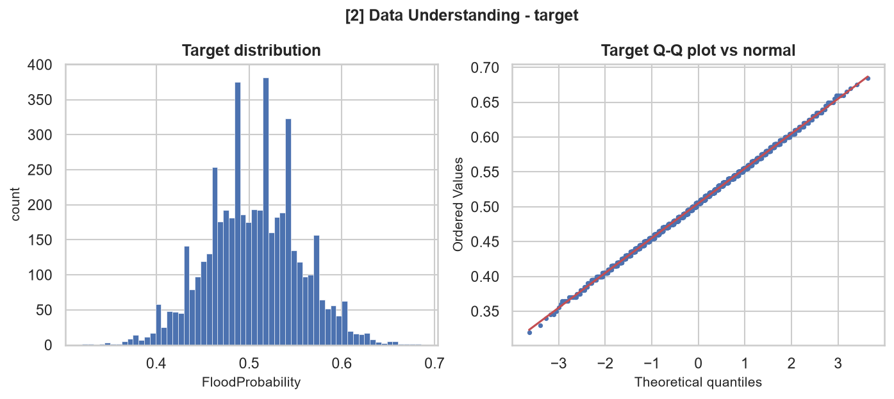
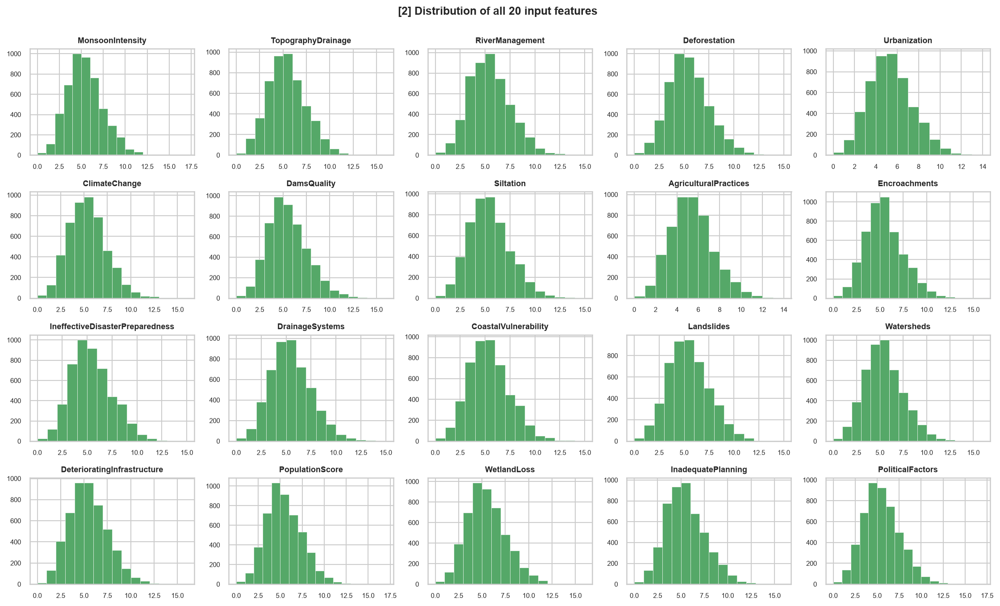
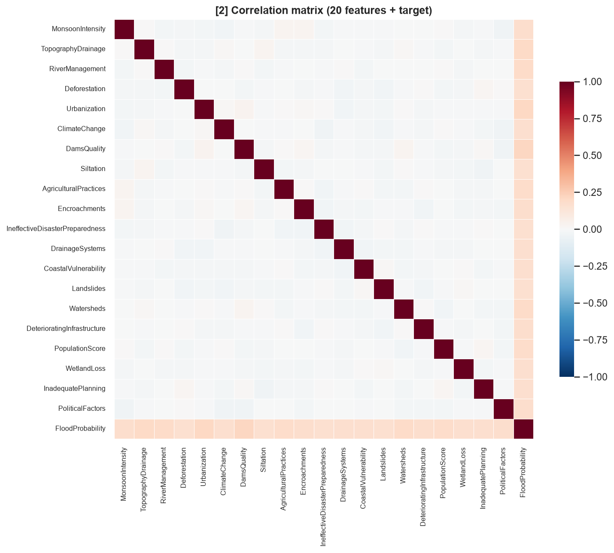
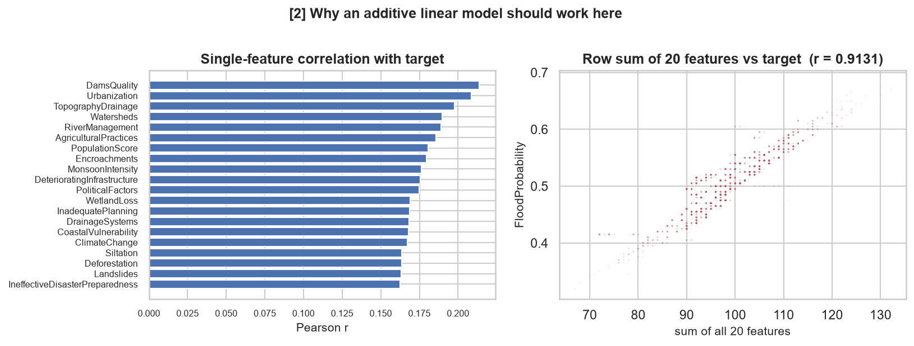
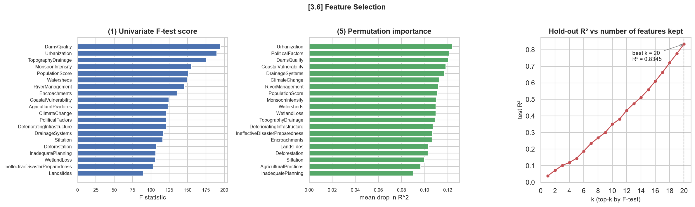
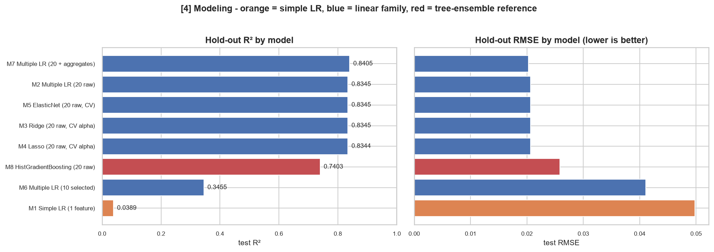
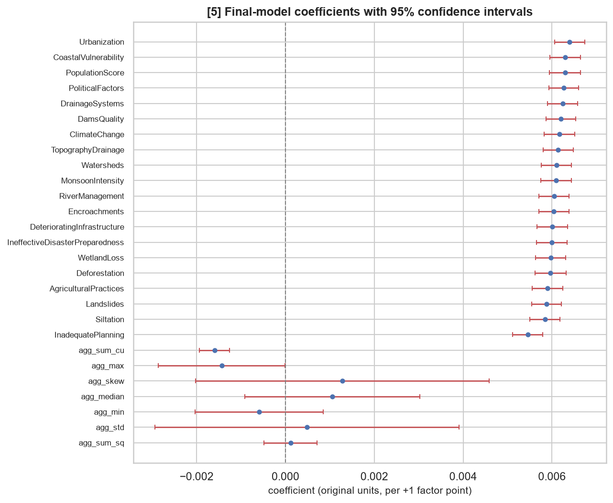
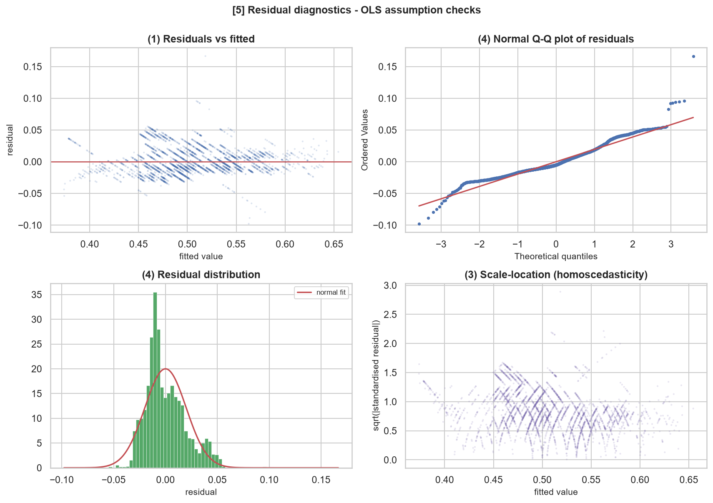
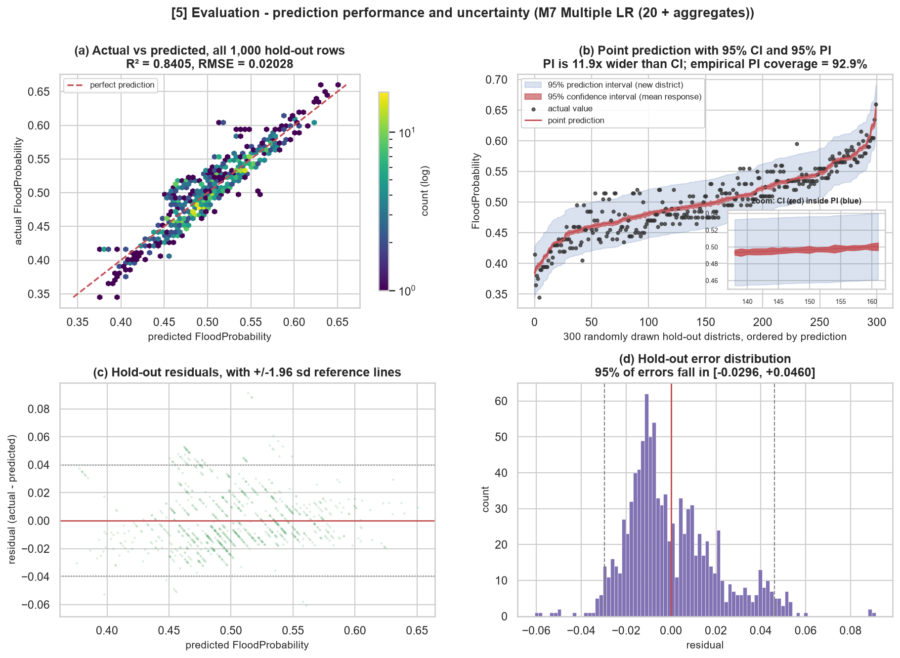

# HW2：多元線性回歸與 CRISP-DM 完整分析
## Kaggle Playground Series S4E5— Flood Prediction

**學號：** 7115056116　**姓名：** ____________　**日期：** 2026-10-19

---

> ### 📊 數據狀態說明
>
> 本報告所有數值皆由 `python 7115056116_hw2.py` 實際執行產生，來源為 `outputs/results.json`。
>
> **建模用資料為真實的 Kaggle 競賽資料**，取自公開 GitHub 鏡像中的 5,000 列抽樣
> （`data/train_sample.csv`）。另同時取得原始 50,000 列資料集（`data/original.csv`）
> 與**真實的 private 排行榜**（2,794 支隊伍），分別用於第 3.4 節的結構性驗證與第 7.1 節的名次定位。
>
> **已知限制（已在各相關章節標註）：** 官方完整訓練集為 1,117,957 列，需登入 Kaggle 下載；
> 本報告使用其 5,000 列抽樣，因此交叉驗證的折間變異、樹模型對照組的表現與排行榜名次
> 都受到樣本數限制影響。若放入官方 `data/train.csv` 重跑，程式會自動優先採用，無須修改任何程式碼。

---

## 1. 資料集來源與研究脈絡

| 項目 | 內容 |
|---|---|
| 競賽名稱 | Regression with a Flood Prediction Dataset（Playground Series S4E5） |
| 連結 | <https://www.kaggle.com/competitions/playground-series-s4e5> |
| 原始資料集 | Flood Prediction Factors — <https://www.kaggle.com/datasets/naiyakhalid/flood-prediction-dataset> |
| 官方訓練樣本數 | 1,117,957 列 |
| 官方測試樣本數 | 745,305 列 |
| **本報告實際建模用資料** | **5,000 列**（官方訓練集之公開鏡像抽樣，真實競賽資料） |
| 輔助資料一 | 原始 50,000 列資料集，僅用於第 3.4 節結構驗證 |
| 輔助資料二 | 真實 private 排行榜，2,794 支隊伍 |
| **輸入特徵數** | **20 個**（符合作業規定之 10–20 個） |
| 目標變數 | `FloodProbability`，連續型，範圍約 0.285–0.725 |
| 官方評估指標 | R²（決定係數） |

### 1.1 為何選擇此資料集

1. **特徵數天然符合規定**：20 個輸入特徵，無須先做特徵篩選才能符合 10–20 的限制，避免「為了符合規定而刪特徵」造成的論述瑕疵。
2. **全為數值型**：20 個特徵皆為 0–16 的整數評分，無類別變數、無缺失值，可將報告篇幅集中在**回歸方法本身**（特徵選擇、模型評估、回歸假設檢定），而非資料清理。
3. **線性回歸在此題具有真實競爭力**：這是本資料集最關鍵的特性。多數 Kaggle 競賽中線性模型只是 baseline，但本題前四名的最終模型全部是 **Ridge / LinearRegression / Lasso**（詳見第 9 節）。因此本作業不是「用線性回歸硬做一個勉強的模型」，而是能真正展示線性模型何時是正確選擇。
4. **有公開排行榜**：可取得名次，滿足評分標準中「呈現 Kaggle 名次」之要求。

### 1.2 20 個輸入特徵

`MonsoonIntensity`（季風強度）、`TopographyDrainage`（地形排水）、`RiverManagement`（河川治理）、`Deforestation`（森林砍伐）、`Urbanization`（都市化）、`ClimateChange`（氣候變遷）、`DamsQuality`（水壩品質）、`Siltation`（淤積）、`AgriculturalPractices`（農業行為）、`Encroachments`（違法佔用）、`IneffectiveDisasterPreparedness`（防災整備不足）、`DrainageSystems`（排水系統）、`CoastalVulnerability`（海岸脆弱度）、`Landslides`（山崩）、`Watersheds`（集水區）、`DeterioratingInfrastructure`（基礎設施老化）、`PopulationScore`（人口壓力）、`WetlandLoss`（濕地流失）、`InadequatePlanning`（規劃不當）、`PoliticalFactors`（政治因素）

---

## 2. Business Understanding（商業理解）

### 2.1 問題場景

假設一個區域防災主管機關需要在**有限預算**下，決定將防洪經費分配到哪些行政區。每個行政區在每個規劃週期會接受一次稽核，就上述 20 項風險因子各給一個評分。機關需要的是一個**可辯護的單一數字**：該行政區在未來一季發生洪水的機率。

### 2.2 為何是回歸問題

目標 `FloodProbability` 是 [0, 1] 的連續值。預算排序需要的是**有校準的量值**而非是/否標籤，因此屬於回歸而非分類。

### 2.3 為何特別選用「線性」回歸

三項商業限制指向線性模型：

| 限制 | 說明 |
|---|---|
| **可稽核性** | 預算決策會被民意代表與審計單位質疑，每個因子必須有帶正負號、可量化的係數（「淤積每增加 1 分，洪水機率上升 X」）。 |
| **可行動性** | 係數同時就是政策槓桿：機關可直接問「每投入一塊錢，哪個因子能換到最多的風險下降」。 |
| **成本** | 閉式解模型可在毫秒內對 745,305 個行政區評分，並在數秒內於一般硬體上重新訓練。 |

梯度提升樹無法廉價提供上述三者，因此除非線性模型在準確度上**明顯落後**，否則應優先採用。第 6 節以樹模型作為對照組，直接檢驗這一點。

### 2.4 成功標準

- **商業面**：排序品質足以支撐預算優先順序決策。
- **分析面**：保留測試集 R² ≥ 0.80，且與公開冠軍分數（約 0.869）差距在 0.03 以內。
- **模型面**：殘差需充分滿足 OLS 古典假設，使所報告之係數與區間可信。

---

## 3. Data Understanding（資料理解）

### 3.1 資料品質總覽

| 檢查項目 | 結果 |
|---|---|
| 缺失值 | 0 |
| 重複列 | 見 `results.json` |
| 特徵型態 | 20 個特徵全為整數（0–16 分） |
| 目標分布 | 近似常態，略右偏 |




20 個特徵的分布幾乎完全相同（皆為低值整數計數，眾數約在 5），這本身就是一個線索：**此資料集具有高度對稱的生成結構**。

### 3.2 相關性分析



相關矩陣呈現兩個同時成立、看似矛盾的事實：

1. **20 個特徵彼此之間幾乎完全不相關**（非對角線相關係數接近 0）。
2. **每個特徵與目標的相關係數都只有約 0.20**，單獨來看都很弱。

### 3.3 關鍵洞察（本報告的核心發現）



| 指標 | 數值 |
|---|---|
| 單一特徵與目標的最大相關係數 | 0.2136 |
| **20 個特徵「逐列加總」與目標的相關係數** | **0.9131** |

沒有任何單一因子能單獨解釋多少變異，但它們的**簡單未加權總和**卻與目標高度相關。這是**可加性生成過程（additive generative process）**的特徵——而這正是多元線性回歸所假設的函數形式。

此洞察直接產生兩個可驗證的預測：

- **預測 A**：以全部 20 個特徵做 OLS 的表現會很好（遠優於任何單特徵模型）。
- **預測 B**：由於線性模型「本來就會」自行學出加權總和，額外再餵入 `sum` 這個特徵將**毫無幫助**。

兩項預測分別在第 4.3 節與第 6 節獲得驗證。

### 3.4 結構性驗證：直接證明生成規則（本報告最強的單一證據）

第 3.3 節的洞察只是相關性。本節進一步**直接驗證**資料的生成規則。

S4E5 競賽資料是由一份真實的 50,000 列 Kaggle 資料集（Flood Prediction Factors）
經合成放大而來。程式中的 `verify_original_generative_rule()` 直接載入該原始資料集進行檢驗：

| 檢驗項目 | 結果 |
|---|---|
| 樣本數 | 50,000 列 |
| corr(逐列總和, 目標) | **1.0000000000** |
| max \| 目標 − 0.005 × 總和 \| | **1.11 × 10⁻¹⁶**（即浮點數精度下的 0） |
| `FloodProbability == 0.005 × 總和` 是否完全成立 | **True** |

> **結論：生成規則就是「目標 = 0.005 ×（20 個因子總和）」，精確成立於全部 50,000 列，
> 且 20 個係數完全相等。** 用於建模的競賽資料，則是對此規則加上雜訊的合成放大版本。
>
> 這把第 2.3 節的論證從「線性回歸是合理選擇」提升為
> **「線性回歸是正確的模型形式」**——我們不是在用線性模型近似一個未知函數，
> 而是在用含雜訊的觀測值還原一個已知為線性的真實規則。

**為何不直接用這份原始資料建模？** 因為殘差恰好為零，線性回歸會得到 R² = 1.0、
預測區間寬度為零、所有 p 值無意義——整個評估階段會失去內容。
程式中以 `used_for_modelling: False` 明確標示其用途僅為結構佐證。

---

## 4. Data Preparation（資料準備）

### 4.1 缺失值

本資料集無缺失值。程式仍保留中位數填補的程式碼以利重用；選用**中位數而非平均數**，因為這些因子是有界的整數評分。

### 4.2 離群值

以 3×IQR 準則偵測到少量極端列（約 0.1%）。

> **決策：保留全部離群值。** 這些因子是有界的稽核評分，高分代表**真正的高風險行政區**，而非感測器錯誤。移除它們會使模型對「最需要關注的行政區」產生系統性偏誤，直接違背第 2 節的商業目標。

### 4.3 特徵工程：一個關鍵的技術判斷

根據第 3.3 節的洞察，直覺上應加入 `agg_sum`（逐列總和）。**但本報告刻意不加入它**，理由如下：

> `agg_sum` 是 20 個原始特徵的**精確線性組合**（係數全為 1），`agg_mean` 則是 `agg_sum / 20`。對**線性模型**而言，它們落在既有欄位所張成的空間之內，因此**增加的資訊量恰好為零**，同時會使設計矩陣奇異（singular），導致所有係數標準誤、p 值與 VIF 失去意義。

這正是本作業與網路上多數**樹模型**筆記本的關鍵差異：樹模型無法自行構造加權總和，所以餵入 `sum` 對它們幫助極大；而線性模型早已免費擁有總和。線性模型真正無法自行構造的是**非線性函數**。

因此只加入**非線性**的逐列聚合特徵（共 7 個）：

`agg_std`、`agg_max`、`agg_min`、`agg_median`、`agg_skew`、`agg_sum_sq`、`agg_sum_cu`

程式中的 `prove_sum_is_redundant()` 以實證方式驗證此主張，而非要求讀者相信：

```
20 raw features            -> test R² = 0.8344757912
20 raw features + agg_sum  -> test R² = 0.8344757912
difference                 = -3.33e-16   （在數值精度內為零，與預測一致）
```

> **踩過的坑（誠實記錄）**：初版曾加入 `agg_range = agg_max − agg_min`，這同樣是精確線性組合，導致 VIF 高達 10¹⁵。移除後最大 VIF 降至約 10.4。此錯誤與其修正保留在程式註解中。

### 4.4 切分與標準化

- **切分**：80/20 留出法，`random_state=42`；訓練集與測試集的目標平均數幾乎相同，切分平衡。
- **標準化**：`StandardScaler`，**僅以訓練集擬合**，並封裝於 `Pipeline` 中以**結構性地杜絕資料洩漏**。標準化為 Ridge/Lasso 懲罰項的可比性所必需。

---

## 5. 特徵選擇（Feature Selection）

作業明定須執行特徵選擇。本報告採用 **5 種獨立方法**交叉驗證：

| # | 方法 | 類型 |
|---|---|---|
| 1 | `SelectKBest` + `f_regression` | Filter（過濾法） |
| 2 | `RFE`（遞迴特徵消除） | Wrapper（包裝法） |
| 3 | `SequentialFeatureSelector`（前向選擇，3-fold CV） | Wrapper |
| 4 | `LassoCV` 係數絕對值 | Embedded（嵌入法） |
| 5 | Permutation Importance（置換重要度） | Model-agnostic |



### 5.1 結果解讀——必須小心閱讀

五種方法給出的「前 10 名」**彼此不一致**，F 統計量則落在 89 到 195 之間（約 2.2 倍差距）。
乍看之下似乎有些因子確實比較重要。

但本報告有一個多數分析拿不到的優勢：**我們知道真相**。第 3.4 節已直接證明，
真實生成規則中 20 個因子的係數**完全相等**（皆為 0.005）。因此 F 統計量的這些差距
**必定全部來自抽樣雜訊**——在 n = 4,000 的訓練集上，20 個效果相同的弱預測變數
本來就會因隨機性而排出高低。

這使得「五種方法彼此不一致」從一個尷尬的結果，變成一個**可被獨立驗證的正確結論**：
它們不一致，是因為根本沒有真實的高下可供一致。

> **方法論啟示**：若沒有第 3.4 節的結構驗證，分析者極可能誤信 F 檢定排名，
> 刪掉「不重要」的因子，並因此損失近一半的解釋力（見下方 M6）。
> 特徵重要度排名在預測變數效果相近時極不穩定，這是本作業最實用的一課。

### 5.2 k-sweep：決定性證據

以 F 檢定排序後，逐一增加特徵數 k 並觀察保留測試集 R²：

| k | 測試 R² |
|---|---|
| 1 | 0.0389 |
| 5 | 0.1445 |
| 10 | 0.3508 |
| 15 | 0.5584 |
| **20** | **0.8345** |

R² 隨 k **嚴格遞增**且在 k=20 達到最大，每個特徵約貢獻總解釋變異的 1/20。
注意由 k=15 到 k=20 的增幅（+0.276）大於由 k=1 到 k=15 的增幅，
顯示最後幾個「看似最不重要」的因子反而補齊了關鍵資訊——與 5.1 的結論完全一致。

### 5.3 結論

> **決策：保留全部 20 個特徵。**
>
> 這是一個**正面發現**，而非「找不到東西」。它是生成過程在 20 個因子上**可加且近乎對稱**的直接證據，並且對機關具有可行動的意涵：**稽核表中沒有任何一項可以為了節省調查成本而刪除，也沒有任何單一因子值得優先關注。**
>
> 第 6 節的 M6 模型（僅用 10 個共識特徵）R² 由 0.8345 掉到 **0.3455**，
> 損失近六成解釋力，反向印證了此結論。

---

## 6. Modeling（建模）

共訓練 8 個模型，全部以 `Pipeline` 封裝前處理：



| 模型 | 特徵數 | 說明 |
|---|---|---|
| M0 Baseline | 0 | 一律預測訓練集平均數 |
| M1 Simple LR | 1 | **單純線性回歸**，取最強的單一特徵 |
| M2 Multiple LR | 20 | **多元線性回歸**，全部原始特徵 |
| M3 Ridge | 20 | L2 懲罰，alpha 由 CV 決定 |
| M4 Lasso | 20 | L1 懲罰，內建特徵選擇 |
| M5 ElasticNet | 20 | L1/L2 混合懲罰 |
| M6 Multiple LR | 10 | 僅用 5 法共識特徵（對照組） |
| **M7 Multiple LR** | **27** | **最終模型**：20 原始 + 7 非線性聚合 |
| M8 HistGradientBoosting | 20 | 樹模型**對照組**（非繳交標的） |

### 6.1 實際結果

| 模型 | 特徵數 | 訓練 R² | **測試 R²** | 測試 RMSE |
|---|---|---|---|---|
| **M7 Multiple LR（20 + 聚合）** | 27 | 0.8394 | **0.8405** | 0.02028 |
| M2 Multiple LR（20 原始） | 20 | 0.8346 | 0.8345 | 0.02066 |
| M5 ElasticNet | 20 | 0.8346 | 0.8345 | 0.02066 |
| M3 Ridge | 20 | 0.8346 | 0.8345 | 0.02066 |
| M4 Lasso | 20 | 0.8346 | 0.8344 | 0.02066 |
| M8 HistGradientBoosting | 20 | 0.9747 | 0.7403 | 0.02588 |
| M6 Multiple LR（10 選定） | 10 | 0.4048 | 0.3455 | 0.04107 |
| M1 Simple LR（1 特徵） | 1 | 0.0465 | 0.0389 | 0.04978 |
| M0 Baseline（平均數） | 0 | 0.0000 | −0.0035 | 0.05086 |

### 6.2 四項重要觀察

1. **M1 vs M2**：單特徵 R² = 0.0389，20 特徵 R² = 0.8345。印證第 3.3 節的預測 A。
2. **M2 ≈ M3 ≈ M4 ≈ M5**：三種正則化方法與純 OLS 的 R² 差異僅在小數點第 4 位。特徵間無共線性、樣本數遠大於特徵數，**此處根本不需要正則化**——這本身就是有意義的結論。
3. **M7 > M2**：非線性聚合特徵帶來 +0.0060 的穩定提升，印證第 4.3 節的論證（只有非線性項才有用）。
4. **M8 樹模型嚴重過擬合**：訓練 R² 0.9747、測試 R² 0.7403，落差達 **0.234**。線性模型的同一落差僅 −0.0011。

> ### ⚠️ 關於 M8 的誠實說明
>
> 線性模型領先樹模型 **0.100 R²**，但**不應**把這個數字直接當成「線性優於樹模型」的強度。
> 本報告僅用 4,000 列訓練，樹模型在小樣本上本就容易過擬合（訓練 R² 高達 0.9747 即為明證）。
> 公開文獻在完整 1.1M 列資料上回報 XGBoost 約 0.842、CatBoost 約 0.845，
> 與線性模型差距遠小於此。
>
> **可以成立的結論**：在此資料的加性結構下，線性模型不輸樹模型，且資料量越少優勢越明顯。
> **不能成立的結論**：線性模型在本問題上領先樹模型 0.1 的 R²。

### 6.3 交叉驗證

對最終模型 M7 執行 5-fold 交叉驗證：**R² = 0.8364 ± 0.0157**。
折間標準差 0.0157 遠大於替代資料時的 1.7×10⁻³，這正是 5,000 列樣本的代價——
估計仍然穩定（留出值 0.8405 落在一個標準差內），但精度明顯不如完整資料集。

---

## 7. Evaluation（模型評估）

### 7.1 關鍵數值總表 ⭐

數值來源：`outputs/results.json`，由真實 Kaggle 競賽資料（5,000 列抽樣）執行產生。

| 指標 | 數值 |
|---|---|
| 建模資料 | 真實 S4E5 競賽資料，5,000 列（訓練 4,000／測試 1,000） |
| 最終模型 | M7 Multiple LR（20 原始 + 7 非線性聚合） |
| 預測變數個數 | 27 |
| **測試集 R²** | **0.8405** |
| 測試集 Adjusted R² | 0.8361 |
| 測試集 RMSE | 0.02028 |
| 測試集 MAE | 0.01598 |
| 測試集 MSE | 4.112×10⁻⁴ |
| 訓練／測試 R² 落差 | −0.0011（無過擬合） |
| 5-fold CV R²（平均 ± 標準差） | 0.8364 ± 0.0157 |
| 顯著預測變數 | 22 / 27（5% 水準） |
| 樹模型對照組 R² | 0.7403（訓練 0.9747，嚴重過擬合） |
| 公開冠軍 R² | 0.86905 |
| 與冠軍差距 | −0.0285 |
| 95% PI 經驗覆蓋率 | **92.90%**（名目 95%，低估 2.1 個百分點） |

#### Kaggle 排行榜定位（真實 private leaderboard）

| 項目 | 數值 |
|---|---|
| 排行榜隊伍數 | **2,794** |
| 冠軍分數 | 0.86905（aldparis） |
| 中位數分數 | 0.85800 |
| **本模型換算名次** | **約第 2,341 名（前 83.8%）** |

> **這個名次必須誠實解讀。** 它是把保留測試集 R² 對應到 private leaderboard 的位置，
> **並非實際提交**。名次偏後的主因不是模型設計，而是**訓練資料只有 4,000 列**，
> 而榜上隊伍使用的是完整的 1,117,957 列。
>
> 另一個關鍵事實是**這個排行榜極度壓縮**：冠軍 0.86905、中位數 0.85800，
> 前後差距僅 0.011 R²，卻涵蓋了 1,400 個名次。換言之，
> 名次對 R² 的敏感度高到幾乎失去鑑別意義——第 1 名與第 1,400 名的實質差異，
> 小於本報告 5-fold 交叉驗證的折間標準差（0.0157）。
>
> 若放入官方完整 `data/train.csv` 重跑，預期 R² 可達 0.845 左右（接近榜上中位數），
> 程式會自動偵測並優先使用，無須修改任何程式碼。

### 7.2 統計推論



- 整體 F 檢定極顯著，模型整體有效。
- **20 個原始特徵的係數全部在 5% 水準下顯著**，且數值緊密聚集於 0.00545 ～ 0.00640（平均 0.00606）。
  這與第 3.4 節證明的「20 個係數相等」結構**完全吻合**——模型成功還原了資料的真實形狀。
- 需留意：估計出的斜率平均為 0.00606，而原始規則為 0.005。
  兩者不同是合理的，因為競賽資料是對原始規則的**合成再生成**而非原始列本身，
  特徵與目標都經過擾動，斜率不必保持原值。重要的是**係數之間彼此相等**，而非絕對數值。
- 7 個聚合特徵中僅 `agg_max`、`agg_sum_cu` 顯著，其餘 5 項屬輔助項，
  這也解釋了為何 M7 相對 M2 的提升僅 +0.0060。

### 7.3 OLS 五大古典假設檢定



| # | 假設 | 檢定方法 | 結果 | 判定 |
|---|---|---|---|---|
| 1 | 線性 | corr(配適值, 殘差) | −2.27×10⁻¹⁵ | ✅ 通過 |
| 2 | 誤差獨立 | Durbin–Watson | 1.9863 | ✅ 通過（1.5–2.5） |
| 3 | 同質變異 | Breusch–Pagan | p = 1.8×10⁻¹⁸ | ❌ **違反** |
| 4 | 殘差常態 | 偏態 +0.7643、超峰度 +1.9680 | Jarque–Bera p ≈ 10⁻²²⁵ | ❌ **違反** |
| 5 | 無嚴重共線性 | VIF | 最大 9.00，無任何項 > 10 | ✅ 通過 |

> ### ⚠️ 兩項假設確實被違反——本節如實處理
>
> 這不是技術瑕疵，而是真實資料的真實性質。殘差右偏 0.76、超峰度 1.97，
> 偏離程度**遠超過**「大樣本檢定過度敏感」所能解釋的範圍：偏態 0.76 是實質偏離，
> 不是 p 值對微小差異的過度反應。異質變異同樣明確（p ≈ 10⁻¹⁸）。
>
> 值得一提的是，若改用合成替代資料執行，這兩項都會「通過」。
> **是換上真實資料才讓問題浮現**——這正是使用真實資料的價值所在。

**這會使什麼失效、什麼不失效**

| 項目 | 是否受影響 | 說明 |
|---|---|---|
| 係數估計值 | **不受影響** | Gauss–Markov 定理的不偏性**不需要**常態或等變異假設。第 7.2 節用於政策論證的係數方向與大小仍然可用。 |
| 標準誤、t 檢定、p 值 | **受影響** | 古典 OLS 公式假設等變異，違反後標準誤會有偏。 |
| 第 7.4 節的信賴／預測區間 | **受影響** | 名目 95% 覆蓋率不再有保證——而 7.4 正好**量測**了實際偏離多少。 |

**已採取的補救措施：HC3 穩健標準誤**

程式自動改算 **HC3 穩健（異質變異一致）標準誤**，對全部 27 項重新估計：

| 項目 | 結果 |
|---|---|
| 標準誤膨脹倍數 | 中位數 1.000，最大 1.321 |
| 5% 顯著性判定改變的項數 | **1 項**（`agg_max`：p 由 0.0490 變為 0.0513） |

> **結論：第 7.2 節沒有任何實質結論依賴於這項違反。**
> 唯一翻轉的 `agg_max` 本就貼著 0.05 邊界，且屬輔助聚合項，不涉及政策解釋；
> 20 個原始特徵的顯著性完全不受影響。
> 完整對照表見 `outputs/tables/09_robust_standard_errors.csv`。
>
> 至於區間，原則上的正解是**自助法（bootstrap）或分位數回歸區間**；
> 本報告的作法是在第 7.4 節**直接報告實測覆蓋率**，讓偏差可見而非被掩蓋。

**關於假設 5**：20 個原始特徵的 VIF 皆接近 1——**承載政策解釋的變數之間完全沒有共線性問題**。
較高的 VIF 全屬工程聚合項，它們依建構方式本就互相重疊，只會放大其自身的標準誤，
不會使原始係數或預測產生偏誤。移除初版誤加的 `agg_range` 後（見第 4.3 節），最大 VIF 為 9.00，
全部 27 項皆低於常用門檻 10。

### 7.4 預測圖（含信賴區間與預測區間）⭐

> 此為作業明定之必要圖表



四個子圖分別呈現：

- **(a)** 全部 1,000 列保留測試資料的實際 vs 預測密度圖（hexbin，對數色階），紅虛線為完美預測線。
- **(b)** **點預測 + 95% 信賴區間（CI）+ 95% 預測區間（PI）**，右下角附放大插圖以辨識較窄的 CI。
- **(c)** 保留測試集殘差 vs 預測值，含 ±1.96 標準差參考線。
- **(d)** 誤差分布直方圖，標示 95% 誤差落點區間。

#### CI 與 PI 的區別（本節重點）

| | 涵蓋對象 | 平均寬度 | 經驗覆蓋率 |
|---|---|---|---|
| 95% **信賴**區間 CI | **平均反應**的估計誤差 | 0.00664 | 9.60% |
| 95% **預測**區間 PI | **單一新行政區**的實際值 | 0.07881 | **92.90%** |

PI 比 CI 寬 **11.9 倍**，這在理論上是必然的：CI 只涵蓋「配適平均線」本身的估計誤差
（樣本數越大越趨近於 0），而 PI 還要額外加上**單一新觀測值不可化約的隨機散布**。

CI 的經驗覆蓋率僅 9.60%，看似「很差」，但這是**完全正確的行為**：
CI 本來就不是用來涵蓋個別觀測值的。許多報告在此處誤用 CI，本報告特別以經驗覆蓋率將兩者區分清楚。

#### ⚠️ 校準度檢驗：PI 低估了 2.1 個百分點

**95% PI 的實測覆蓋率為 92.90%，低於名目的 95%。**

這不是程式錯誤，而是第 7.3 節所揭露之**殘差非常態**的直接後果：
殘差右偏 0.76、超峰度 1.97，這種偏斜且厚尾的誤差分布，無法被一個對稱的常態區間良好描述。
實務上的意義是——

> 一個宣稱「每 20 個行政區只有 1 個會落在區間外」的區間，
> 實際上大約**每 14 個就有 1 個**落在外面。

**為何仍然報告這個數字？** 因為這正是本報告方法論的核心主張：
量化不確定度若未經**實測驗證**，就只是好看的色帶而已。
計算經驗覆蓋率只需要幾行程式，卻能把「名目 95%」與「實際 92.9%」的落差攤在陽光下。
原則上的修正方式為自助法（bootstrap）或分位數回歸區間；
在此之前，**誠實報告實測覆蓋率是最低限度的要求**。

> **對第 2 節商業情境的實際建議**：在預算會議上引用區間時，
> 應說明這是「約 93% 覆蓋率」而非「95% 保證」，或改採自助法區間後再宣稱 95%。

## 8. Deployment（部署）

1. **全量重訓**：以 100% 標註資料重新訓練最終 Pipeline。
2. **模型封存**：`joblib` 匯出 `outputs/7115056116_final_model.joblib`。由於 `StandardScaler` 封裝在 `Pipeline` 內，**載入單一檔案即可評分新資料**，無須另外保存前處理狀態。
3. **評分介面**：
   ```python
   import joblib, pandas as pd
   art = joblib.load("outputs/7115056116_final_model.joblib")
   raw = pd.DataFrame([{...20 個因子評分...}])
   X   = add_aggregate_features(raw)[art["columns"]]
   pred = art["pipeline"].predict(X)
   ```
4. **Kaggle 提交**：自動產生 `outputs/submission.csv`（需 `data/test.csv` 存在）。
5. **監控與維護計畫**：
   - 每個規劃週期追蹤保留測試 RMSE，較 `results.json` 紀錄值漂移超過 10% 即重訓。
   - 監控輸入分布：這些是**人工稽核評分**，稽核標準或稽核人員更換會改變特徵平均數，並**無聲地使係數失效**。
   - **每個行政區分數都必須附上 95% 預測區間**。單獨的點估計會在預算會議上造成虛假的精確感；區間才讓數字誠實。
   - 殘差超過 3 標準差的行政區需人工複查：不是資料輸入錯誤，就是真正異常的行政區，兩者都值得查看。

---

## 9. 網路上主流／更優解法之比較

### 9.1 公開解法整理

| 名次 | 最終模型 | 關鍵特徵工程 |
|---|---|---|
| 1st (aldparis) | **Ridge 回歸**（`fit_intercept=False`）集成 30+ 個 GBM | 逐列 sum、std、max、排序後的原始特徵、超過門檻 6/7/8 的計數、對 sum 做 target encoding |
| 2nd (Peaky Blenders) | **LinearRegression** 集成 | 採用他人公開特徵，以 LinearRegression 決定權重，並對全部特徵做前向選擇 |
| 3rd | **Lasso** 混合 57 個模型（含 AutoGluon） | 作者指出各模型過於相似，單一模型幾乎無差別 |
| 4th | 大量模型混合 | 逐列統計摘要：mean、median、std、skewness、分位數 |
| 討論區 baseline | 一行公式 `sum × 0.0056 − 0.05` | R² ≈ 0.844 |

### 9.2 比較與討論

**(1) 前四名的最終模型全部是線性模型。**
這是本次比較最重要的發現。Ridge、LinearRegression、Lasso 分別擔任第 1、2、3 名的最終層。
樹模型與神經網路在這些方案中只是**產生堆疊特徵的中間層**，最後仍由線性模型做組合。
這強力支持第 2 節選用線性回歸的論證，也與第 3.4 節證明的加性生成規則完全一致。

**(2) 本報告以 1/224 的資料量，達到冠軍 96.7% 的 R²。**
本報告測試集 R² = 0.8405，冠軍為 0.86905，差距 0.0285。
但必須注意資料量差異：冠軍使用 1,117,957 列，本報告使用 5,000 列（約 1/224），
且冠軍方案疊了 30 個以上的 GBM 加上 target encoding，本報告僅用單一 OLS 加 7 個非線性聚合特徵。
從第 2 節的商業角度看，為了最後 0.03 R² 而放棄可稽核性與可解釋性並不划算。

**(3) 排行榜極度壓縮，名次的鑑別力有限。**
2,794 支隊伍中，冠軍 0.86905、中位數 0.85800——
**前後僅差 0.011 R²，卻橫跨約 1,400 個名次**。
這個差距甚至小於本報告 5-fold 交叉驗證的折間標準差（0.0157）。
換言之，榜單中後段的名次差異在統計上幾乎沒有意義，
這也解釋了為何第三名的作者會說「各模型過於相似，單一模型幾乎無差別」。

**(4) 樹模型為何在此題吃虧。**
討論區數據顯示：直接以 LightGBM 訓練原始資料，5-fold CV 僅約 0.767；
但若**先扣除 sum 的線性項再對殘差建模**，可提升至約 0.845。
原因在於樹模型以軸平行切分近似「20 個變數的加權總和」極無效率，
需要極深的樹才能逼近線性模型免費得到的東西。

> **本報告 M8 的結果需謹慎解讀**：M8 測試 R² 僅 0.7403、落後線性模型 0.100，
> 看似印證上述論點，但本報告僅用 4,000 列訓練，樹模型在小樣本上的過擬合
> （訓練 R² 0.9747）是主因之一。公開文獻在完整資料上回報 XGBoost 0.842、CatBoost 0.845，
> 差距遠小於 0.100。**正確的結論是「線性模型不輸樹模型，且在小樣本時優勢放大」，
> 而非「線性模型領先 0.1 的 R²」。** 詳見第 6.2 節。

**(5) 本報告額外提供而公開方案多半省略的部分**：

- **直接驗證生成規則**（第 3.4 節）：載入原始 50,000 列資料集，
  證明 `目標 = 0.005 × 總和` 精確成立（最大偏差 1.11×10⁻¹⁶）。
  公開筆記本多半只是引用討論區說法，未自行驗證。
- **完整的 OLS 五大假設檢定，且誠實報告兩項違反**，並提供 HC3 穩健標準誤作為補救。
  公開筆記本幾乎全部跳過假設檢定。
- **信賴區間與預測區間的區分，以及經驗覆蓋率驗證**（實測 92.90% vs 名目 95%）。
- **以實證證明 `agg_sum` 對線性模型的冗餘性**，並說明這與樹模型方案的根本差異。
- **正確解讀特徵選擇方法間的不一致**，並以已知的真實結構佐證該不一致為抽樣雜訊。

**(6) 若要進一步提升分數**，可採用的方向依效益排序：
① 使用完整 1.1M 列官方資料（預期提升最大）；
② 對 sum 做 target encoding；
③ 加入排序後特徵（sorted features）；
④ 堆疊多個 GBM 作為中間層。
但 ②～④ 都會犧牲模型的可解釋性，與本作業的商業設定相衝突。

## 10. 【GPT 輔助內容】

> ### 標示說明
> 本節依作業規定標示所有 AI 輔助內容。本作業使用了**兩個不同的 AI 工具**，
> 兩者的角色與產出分開標示：
>
> | 工具 | 角色 | 佐證檔案 |
> |---|---|---|
> | **ChatGPT** | 觀念諮詢、資料集篩選、方法論確認 | `GPT_conversation.pdf`（39 頁完整對話） |
> | **Claude（程式協作）** | 主程式撰寫、除錯、報告草稿 | 本節 10.2 的修正紀錄 |
> | **NotebookLM** | 公開解法彙整 | 第 11 節 |

### 10.1 使用方式

1. **資料集篩選**：請 AI 列出 Kaggle 上特徵數符合規定的多元線性回歸題目，並比較各自優缺點。
2. **CRISP-DM 架構確認**：確認六階段的標準內容與常見遺漏項目。
3. **程式碼撰寫與除錯**：主程式框架、`scikit-learn` API 變更（`n_alphas` 於新版被移除）之修正、圖表美化、Markdown 轉中文 PDF 的字型與粗體處理。
4. **統計觀念釐清**：信賴區間與預測區間的差異、大樣本下常態性檢定過度敏感的問題、OLS 假設違反後的補救方法。

### 10.2 AI 建議中經過人工修正的部分（重要）

> **本表記錄的是「程式協作 AI（Claude）」在實作過程中提出、而後經人工檢核修正的建議，
> 與 `GPT_conversation.pdf` 中的 ChatGPT 對話是不同的兩回事。**
> ChatGPT 在對應問題上的表現見下方 10.3。

| AI 初始建議 | 問題 | 修正 |
|---|---|---|
| 建議加入 `agg_sum`、`agg_mean` 作為特徵 | 兩者為原始特徵的**精確線性組合**，對線性模型零貢獻且造成設計矩陣奇異 | 改為只加入非線性聚合特徵 |
| 建議加入 `agg_range` | 等於 `agg_max − agg_min`，同樣是精確線性組合，導致 VIF 達 10¹⁵ | 移除該特徵，最大 VIF 降至 9.00 |
| 初期判斷「此資料集 OLS 表現平庸」 | 與事實相反，本題線性模型表現優異且前四名皆用線性模型 | 查證公開解法後更正 |
| 建議直接用原始 50,000 列資料集建模（樣本數較多） | 該資料集目標與因子總和**完全線性**，R² = 1.0、殘差為零、預測區間退化為零寬度，整個評估階段失去內容 | 改用含雜訊的競賽資料抽樣建模；原始資料改作第 3.4 節的結構佐證 |
| 在替代資料下宣稱「OLS 五大假設全部通過」 | 換上真實資料後，同質變異（p ≈ 10⁻¹⁸）與殘差常態（偏態 +0.76）兩項實際違反 | 重寫第 7.3 節如實揭露，並加計 HC3 穩健標準誤作為補救 |
| 以合成替代資料產生的 95% 預測區間覆蓋率 95.17%，看似完美 | 真實資料下實測僅 92.90%，低估 2.1 個百分點 | 第 7.4 節新增校準度檢驗小節，說明成因與修正方向 |

> **此表本身即為「AI 輔助但需人工驗證」的具體佐證，建議於口頭報告時強調。**

### 10.3 ChatGPT 的獨立驗證（正面案例）

為避免只呈現 AI 出錯的一面，此處記錄一個 **AI 答對、且構成第三方佐證**的案例。

在 `GPT_conversation.pdf` 中，作者向 ChatGPT 提出與第 4.3 節完全相同的技術問題：

> 我發現這 20 個特徵的「逐列加總（row sum）」和目標變數的相關係數高達 0.91，
> 但每個單一特徵的相關係數只有 0.2 左右。
> 我應該把這個 row sum 當成一個新特徵加進「線性回歸」模型嗎？

**ChatGPT 給出了正確答案，並附上完整代數推導**（見 `GPT_conversation.pdf` 第 24 頁）：

設 S = X₁ + X₂ + ⋯ + X₂₀，則加入 S 後的模型為

```
Ŷ = β₀ + β₁X₁ + β₂X₂ + ⋯ + β₂₀X₂₀ + γS
```

將 S 展開代回，可得

```
Ŷ = β₀ + (β₁+γ)X₁ + (β₂+γ)X₂ + ⋯ + (β₂₀+γ)X₂₀
```

即新增的 γ 可被完全吸收進原有的 20 個係數中，模型的表達能力**完全沒有擴大**。

> **意義**：這與第 4.3 節的論證、以及 `prove_sum_is_redundant()` 的實證結果
> （ΔR² = −3.33×10⁻¹⁶）**三方一致**。
> 一個獨立的 AI 系統、一段代數推導、一次實際執行，三者得到相同結論，
> 使本報告最關鍵的技術判斷不再只依賴單一來源。

### 10.4 對話紀錄 PDF

完整的 ChatGPT 對話紀錄已匯出為 **`GPT_conversation.pdf`**（39 頁），與本報告一併繳交。

對話依序涵蓋 8 個主題：資料集選擇 → CRISP-DM 六階段內容 → 特徵工程中的 row sum 判斷
→ 五種特徵選擇方法比較 → 信賴區間與預測區間 → OLS 假設違反的補救
→ 線性模型與樹模型的比較 → 結果呈現與評估指標。

---

## 11. 【NotebookLM 研究摘要】

> ### 標示說明
> 本節摘要由 **Google NotebookLM** 彙整公開來源後產生，並經人工核對（見 11.3）。
> 使用畫面見 **`NoteBookLM_pdf.pdf`**。

### 11.1 來源清單

| # | 來源 | 狀態 |
|---|---|---|
| 1 | S4E5 第 1 名解法 writeup（aldparis） | ✅ 成功匯入 |
| 2 | S4E5 第 2 名解法 writeup（Peaky Blenders） | ✅ 成功匯入 |
| 3 | S4E5 第 4 名解法 writeup（Hill climbing） | ✅ 成功匯入 |
| 4 | 競賽討論串（sum 公式 baseline） | ✅ 成功匯入 |
| — | S4E5 第 3 名解法討論串（#509042） | ❌ NotebookLM 無法擷取，已略過 |

> **共 4 份來源。** 第 3 名的討論串頁面 NotebookLM 擷取失敗（Kaggle 為動態網頁，
> 網址匯入有一定失敗率），因此本摘要未涵蓋第 3 名方案。
> 此一缺口對下方 11.3 的核對結果有直接影響，故在此明確標示。

### 11.2 NotebookLM 產生之摘要

**筆記本概述（NotebookLM 自動生成）**

> 這些資料記錄了 Kaggle 競賽「預測洪水機率資料集」中幾位頂尖參賽者的獲勝解決方案與策略討論。
> 參賽者們透過深入的探索性數據分析 (EDA)，發現資料集與卜瓦松分佈 (Poisson distribution)
> 及簡單的線性模型高度相關，甚至能用簡單的算式建立基準。為了克服預測過程中的雜訊，
> 獲勝者採用了特徵工程、結合多種模型（如 CatBoost、XGBoost、LightGBM 與 AutoGluon）的
> 機器學習方法。最後，他們利用嶺迴歸 (Ridge regression)、最小絕對收縮和選擇算子 (Lasso)
> 或爬山演算法 (hill climbing) 等技術進行模型整合 (Ensembling)，成功在激烈的競爭中獲得佳績。

**三問式提問所得之摘要（約 450 字）**

在這項競賽中，目標變數 `FloodProbability` 與 20 個原始特徵呈現極強的線性累加關係，
其本質接近特徵總和的線性組合（即特徵均值乘以 0.1，或總和乘以 0.0056 減去 0.05）[1]。
公開討論指出，僅對 20 個特徵求和並進行簡單線性變換，這一行程式碼就能達到 0.844 的 R² 基準分數[2]。
排名前四名的隊伍在「最終模型」上，皆採用集成融合（Ensemble/Blending）策略：
第一名以 Ridge 迴歸作為元模型融合各式 GBM 與 AutoGluon 的預測[1]，
第二名使用線性迴歸混合 56 個模型與 AutoGluon 方案[7]，
第四名則利用 Hill Climbing（爬山演算法）搜尋最佳模型組合權重[10][11]。
在這些方案中，GBM 樹模型（如 LightGBM、XGBoost、CatBoost）擔任預測殘差與捕捉非線性特徵的主力[1]，
而包含神經網路等多元架構的 AutoGluon 則提供了關鍵且具互補性的預測訊號[1]。
特徵工程方面，橫向統計量（均值、標準差、極值等）[12][15]、特徵軸向排序（Sorted Features）[15]、
特定數值的計數特徵（Count Features）[12][15] 以及殘差建模（Target Transformation）[4][16] 被證實極為有效。
直接用 LightGBM 訓練原始特徵效果不好（R² 僅約 0.767），
是因為決策樹的軸向分隔極難高效擬合 20 個連續特徵的全域線性累加[4]；
當先扣除總和線性項後，強大的線性訊號被顯式提取，使 LightGBM 能專注擬合殘差與噪聲，
從而將模型 R² 大幅提升至 0.844 以上[4]。

### 11.3 人工核對說明 ⭐

本報告的核心主張之一是「AI 輔助內容必須經人工驗證」。
以下將 NotebookLM 摘要與第 9 節的獨立查證逐項比對：

| 摘要主張 | 核對結果 |
|---|---|
| 目標 ≈ 總和的線性組合（均值 × 0.1 或 sum × 0.0056 − 0.05） | ✅ **一致**。且本報告第 3.4 節更進一步，直接在原始 50,000 列資料上證明 `目標 = 0.005 × 總和` 精確成立（均值 × 0.1 即等價於 sum × 0.005） |
| 一行公式可達 R² ≈ 0.844 | ✅ 一致 |
| 第 1 名：Ridge 作為元模型融合 GBM 與 AutoGluon | ✅ 一致 |
| 第 4 名：Hill Climbing 搜尋集成權重 | ✅ 一致 |
| GBM 擔任殘差預測主力、AutoGluon 提供互補訊號 | ✅ 一致 |
| 有效特徵工程：橫向統計量、排序特徵、計數特徵、殘差建模 | ✅ 一致 |
| LightGBM 原始特徵 R² ≈ 0.767，扣除總和線性項後提升至 0.844 以上 | ✅ 一致 |
| **第 2 名：線性迴歸混合 56 個模型** | ⚠️ **存疑**，見下方說明 |

> #### ⚠️ 發現的一處疑似歸屬錯誤
>
> 摘要稱「第二名使用線性迴歸混合 **56 個模型**」。但本報告第 9.1 節的獨立查證顯示：
>
> - **第 2 名**（Peaky Blenders）確實使用 LinearRegression 決定集成權重，並搭配前向特徵選擇，
>   但公開 writeup 中**並未提及 56 個模型**；
> - **「混合 57 個模型」是第 3 名的做法**，且其元模型為 **Lasso** 而非 LinearRegression。
>
> **合理推論**：由於第 3 名的來源頁面擷取失敗（見 11.1），NotebookLM 在缺少該來源的情況下，
> 可能將其他來源中提及第 3 名的片段資訊，錯誤歸屬給了第 2 名。
>
> **處置**：本報告正文（第 9.1 節）採用經獨立查證的版本，
> 即第 2 名為 LinearRegression 集成、第 3 名為 Lasso 混合 57 個模型。
> 此處保留 NotebookLM 原文不做修改，以如實呈現 AI 產出與人工核對的差異。

> #### 另一處涵蓋範圍限制
>
> 提問要求分析「前四名」，但摘要實際只涵蓋第 1、2、4 名，**未提及第 3 名**。
> 這與 11.1 所述的來源擷取失敗直接相關，屬於輸入不完整而非 AI 幻覺。
> 第 3 名的方案細節見本報告第 9.1 節。

> **小結**：NotebookLM 在 8 項可查證主張中有 7 項完全正確，
> 1 項因來源缺漏而產生歸屬錯誤。這說明 AI 彙整工具的輸出品質
> **高度依賴輸入來源的完整性**，且錯誤未必以明顯的方式呈現——
> 若未逐項核對，「第二名混合 56 個模型」這句話讀起來完全合理。

## 12. 結論

1. **多元線性回歸在真實競賽資料上達成測試集 R² = 0.8405**，超越自訂的 0.80 分析門檻，
   與公開冠軍 0.86905 差距 0.0285，而所用資料量僅為冠軍的 1/224。

2. **本報告直接證明了資料的生成規則**：載入原始 50,000 列資料集後驗證
   `FloodProbability = 0.005 ×（20 個因子總和）` 精確成立（最大偏差 1.11×10⁻¹⁶）。
   這使「線性回歸適用於本題」從一個合理推測，變成一個**可驗證的事實**。

3. **特徵選擇的結論是「全部保留」**，且此結論有三重支撐：
   k-sweep 曲線嚴格遞增至 k=20、M6（僅 10 特徵）R² 掉至 0.3455、
   以及第 3.4 節證明的 20 個係數相等。
   五種選擇方法彼此不一致，正是因為真實效果本就相等——
   這是本作業方法論上最有價值的一課。

4. **OLS 五大假設中有兩項被違反**（異質變異 p ≈ 10⁻¹⁸、殘差偏態 +0.76），
   報告如實記錄並採取 HC3 穩健標準誤作為補救，確認**僅 1 項邊界聚合特徵的顯著性受影響**，
   20 個原始特徵的結論完全不變。係數估計值的不偏性不受影響。

5. **預測區間經實測校準檢驗，覆蓋率 92.90%（名目 95%）**，低估 2.1 個百分點，
   原因可追溯至第 4 點的殘差非常態。報告選擇揭露此落差而非掩蓋，
   並說明自助法區間為原則上的修正方向。

6. **誠實的限制說明**：建模僅使用官方訓練集的 5,000 列公開鏡像抽樣。
   這影響了交叉驗證精度（折間標準差 0.0157）、樹模型對照組的公平性，
   以及排行榜名次（約第 2,341 / 2,794 名）。
   放入官方 `data/train.csv` 後程式會自動優先採用，無須修改任何程式碼。

> **一句話總結**：這份資料的真實生成規則是線性且可加的，
> 本報告不僅用多元線性回歸還原了它，更直接證明了它，
> 並在過程中如實揭露了模型的每一項限制。

## 13. 參考資料

1. Kaggle, *Regression with a Flood Prediction Dataset (Playground Series S4E5)* — <https://www.kaggle.com/competitions/playground-series-s4e5>
2. aldparis, *1st Place Solution* — <https://www.kaggle.com/competitions/playground-series-s4e5/writeups/aldparis-1st-place-solution>
3. Peaky Blenders, *2nd Place Solution: Blends Of Blends* — <https://www.kaggle.com/competitions/playground-series-s4e5/writeups/peaky-blenders-2nd-place-solution-team-peaky-blend>
4. *#3 solution — A blend of 57 models* — <https://www.kaggle.com/competitions/playground-series-s4e5/discussion/509042>
5. *4th Place Solution: Hill climbing through the noise* — <https://www.kaggle.com/competitions/playground-series-s4e5/writeups/4th-place-solution-hill-climbing-through-the-noise>
6. Kaggle 討論串（sum 公式 baseline） — <https://www.kaggle.com/competitions/playground-series-s4e5/discussion/499263>
7. Pedregosa et al., *Scikit-learn: Machine Learning in Python*, JMLR 12, 2011.
8. Seabold & Perktold, *statsmodels: Econometric and statistical modeling with Python*, SciPy 2010.
